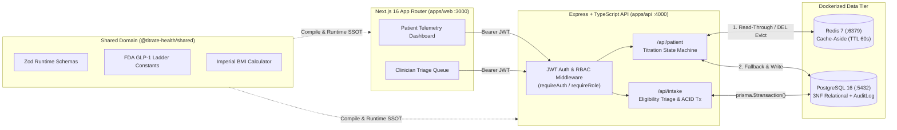
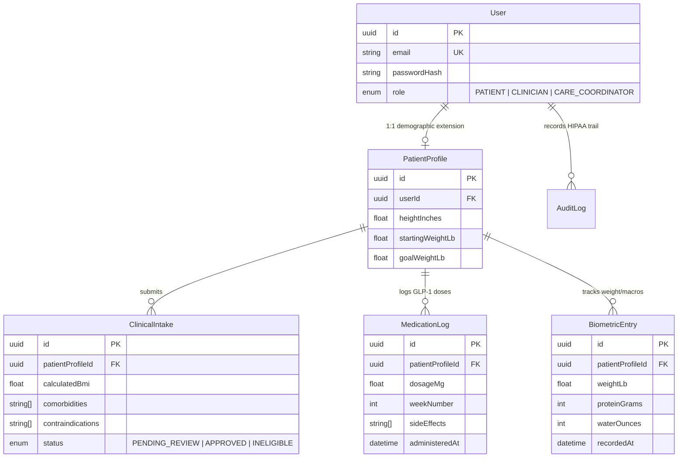

# Titrate-Health 🩺


**Titrate-Health** is a full-stack clinical weight management and **GLP-1 (Semaglutide) titration telemetry & triage platform**. It models the core production workflows used by modern asynchronous telehealth providers: **automated FDA BMI & contraindication intake triage**, **deterministic GLP-1 step-up titration state machines**, **stateless JWT Role-Based Access Control (`PATIENT` / `CLINICIAN`)**, **ACID database transactions**, **Redis cache-aside telemetry**, and **immutable HIPAA audit logging**.

---

## 1. System Architecture



---

## 2. Key Engineering Highlights

### Monorepo Single Source of Truth (`@titrate-health/shared`)
- Uses **npm workspaces** (`apps/api`, `apps/web`, `packages/shared`) so clinical validation rules (`ClinicalIntakeSubmissionSchema`), FDA Semaglutide titration steps (`[0.25, 0.5, 1.0, 1.7, 2.4]` mg), and `calculateBmi()` are defined once and shared across the React client and Express server without schema drift.

### Deterministic Clinical Intake & ACID Transactions (`apps/api/src/routes/intake.ts`)
- Evaluates incoming onboarding payloads against absolute GLP-1 contraindications (`MEDULLARY_THYROID_CARCINOMA_HISTORY`, `MEN2_SYNDROME`, `PREGNANCY_OR_NURSING`, etc.) and FDA BMI criteria (`BMI >= 30.0`, or `BMI >= 27.0` with weight-related comorbidities).
- Wraps `PatientProfile` upsert, `ClinicalIntake` creation, baseline `BiometricEntry` seeding, and HIPAA `AuditLog` insertion inside `prisma.$transaction(...)` to guarantee **all-or-nothing atomicity**.

### GLP-1 Titration Escalation State Machine & Redis Cache-Aside (`apps/api/src/routes/patient.ts`)
- **State Machine**: Evaluates the patient's current Semaglutide step, treatment week number, and reported GI side effects (`MILD_NAUSEA`, `GI_REFLUX`, `FATIGUE`). Automatically holds dose escalation when side effects are present (`HOLD_DOSE_SIDE_EFFECT_MANAGEMENT`) or recommends stepping up after completing a 4-week block (`ELIGIBLE_FOR_STEP_UP`).
- **Redis Cache-Aside Pattern**: `GET /api/patient/dashboard` checks Redis first (`patient:dashboard:<userId>`), returning `cacheSource: "REDIS_HIT"` in `<2ms`. Mutations to `/api/patient/biometrics` or `/api/patient/medication-log` explicitly evict (`DEL`) the cache key so the patient never sees stale clinical telemetry.

### Stateless JWT Authentication, RBAC & HIPAA Audit Trail (`apps/api/src/middleware/auth.ts`)
- Distinguishes **Authentication (`401 Unauthorized` via `requireAuth`)** from **Authorization (`403 Forbidden` via `requireRole(['CLINICIAN'])`)**.
- Persists an immutable `AuditLog` record (`actorId`, `action`, `targetResourceId`, `ipAddress`, `createdAt`) for every PHI read and mutation.

---

## 3. 3rd Normal Form (3NF) Relational Schema



---

## 4. Local Development Quickstart

### Prerequisites
- **Node.js** `>= 20.x`
- **Docker Desktop** (for PostgreSQL 16 and Redis 7)

### 1. Start Infrastructure & Install Dependencies
```bash
docker compose up -d
npm install
```

### 2. Configure Environment & Run Prisma Migrations
Copy `.env.example` to `apps/api/.env` and apply the PostgreSQL schema:
```bash
cp .env.example apps/api/.env
npm run db:migrate --workspace=apps/api
```

### 3. Start the Full-Stack Platform
```bash
# Terminal 1: Start Express API on http://localhost:4000
npm run dev:api

# Terminal 2: Start Next.js Clinical Portal on http://localhost:3000
npm run dev:web
```