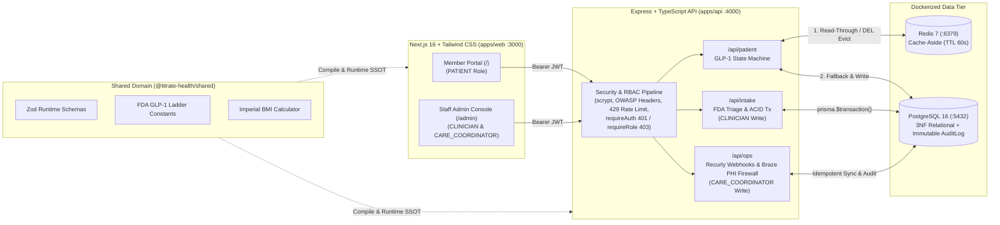
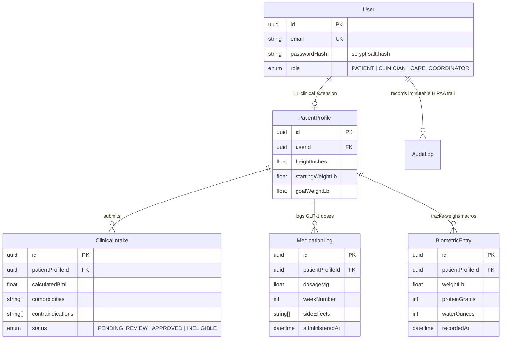

# Titrate-Health 🩺


**Titrate-Health** is a production-architected clinical weight management and **GLP-1 (Semaglutide) titration telemetry, clinician triage, and Recurly entitlement platform**. It models the end-to-end engineering workflows of modern clinical telehealth memberships:
- **Domain-Driven Bounded Contexts**: Separates the consumer **Member Portal (`/`)** from the internal **Staff Admin Console (`/admin`)**.
- **Automated FDA BMI & Contraindication Intake Triage** inside **ACID Database Transactions (`prisma.$transaction`)**.
- **Deterministic GLP-1 Titration Escalation State Machine** with automatic GI side-effect safety holds.
- **Recurly Subscription Lifecycle & Idempotent Webhook Engine** with a **7-Day Clinical Dunning Grace Window**.
- **Server-Side Braze & Amplitude PHI Firewall (`HTTP 202 Accepted`)** that strips medical fields and third-party ad pixels (`ttcsid`, `sc_at`, `t_gid`).
- **Strict RBAC Separation of Duties (`PATIENT`, `CLINICIAN`, `CARE_COORDINATOR`)**, **Salted `scrypt` Cryptography**, **Redis Cache-Aside Telemetry**, and an **Immutable HIPAA Audit Trail (`AuditLog`)**.

---

## 1. System Architecture



---

## 2. Separation of Duties & RBAC Matrix (`/admin` vs `/`)

In regulated healthcare platforms, **no single administrator is permitted to mutate both clinical prescriptions and billing state**, and historical clinical/audit records are strictly append-only:

| Capability / Endpoint | Member (`PATIENT` on `/`) | Clinician (`CLINICIAN` on `/admin`) | Care Coordinator (`CARE_COORDINATOR` on `/admin`) |
| :--- | :---: | :---: | :---: |
| **Submit Intake, Biometrics & GLP-1 Logs** (`POST /api/intake`, `/api/patient/*`) | **Write Allowed** | Blocked (`403`) | Blocked (`403`) |
| **Approve Intake & Prescribe Semaglutide 0.25mg** (`PATCH /api/intake/:id/review`) | Blocked (`403`) | **Write Allowed (ACID Tx)** | **Read-Only (`403` on Write)** |
| **Mutate Recurly Dunning / Auto-Refund Webhooks** (`POST /api/ops/recurly-webhook`) | Blocked (`403`) | **Read-Only (`403` on Write)** | **Write Allowed (Idempotent)** |
| **Dispatch Server-Side Braze / Amplitude Nudges** (`POST /api/ops/telemetry-dispatch`) | Blocked (`403`) | **Read-Only (`403` on Write)** | **Write Allowed (`202 Accepted`)** |
| **HIPAA Compliance Audit Stream** (`GET /api/intake/audit-logs`) | Blocked (`403`) | **Read-Only** | **Read-Only** |
| **Modify or Delete `AuditLog` / Historical Chart Rows** | **Forbidden (Immutable)** | **Forbidden (Immutable)** | **Forbidden (Immutable)** |

---

## 3. Core Engineering Pillars

### A. Monorepo Single Source of Truth (`@titrate-health/shared`)
- Shares `ClinicalIntakeSubmissionSchema`, FDA Semaglutide titration steps (`[0.25, 0.5, 1.0, 1.7, 2.4]` mg), and `calculateBmi()` across the React frontend and Express backend to eliminate contract drift.

### B. Deterministic Clinical Intake & ACID Transactions (`apps/api/src/routes/intake.ts`)
- Evaluates incoming onboarding payloads against absolute GLP-1 contraindications (`MEDULLARY_THYROID_CARCINOMA_HISTORY`, `MEN2_SYNDROME`, `PREGNANCY_OR_NURSING`, etc.) and FDA BMI criteria (`BMI >= 30.0`, or `BMI >= 27.0` with weight-related comorbidities).
- Wraps `PatientProfile` upsert, `ClinicalIntake` creation, baseline `BiometricEntry` seeding, and HIPAA `AuditLog` insertion inside `prisma.$transaction(...)` to guarantee **all-or-nothing atomicity**.

### C. GLP-1 Titration Escalation State Machine & Redis Cache-Aside (`apps/api/src/routes/patient.ts`)
- **State Machine (`evaluateTitrationRecommendation`)**: Inspects the member's current Semaglutide step, treatment week number, and reported GI side effects (`MILD_NAUSEA`, `GI_REFLUX`, `FATIGUE`). Overrides the 4-week step-up schedule with `HOLD_DOSE_SIDE_EFFECT_MANAGEMENT` whenever GI side effects are reported.
- **Redis Cache-Aside Pattern**: `GET /api/patient/dashboard` checks Redis first (`patient:dashboard:<userId>`), returning `cacheSource: "REDIS_HIT"` in `<2ms`. Write operations (`POST /api/patient/biometrics` and `POST /api/patient/medication-log`) immediately evict (`DEL`) the cache key.

### D. Recurly Subscription Sync, Dunning Grace & Braze PHI Firewall (`apps/api/src/routes/ops.ts`)
- **Recurly Entitlement & Dunning Continuity**: Synchronizes clinical `INELIGIBLE` decisions to automatically void/refund Recurly subscriptions (`CANCELED_REFUNDED_INELIGIBLE`), deduplicates incoming Recurly webhooks via idempotency keys, and activates a **7-day clinical continuity grace period** on `dunning.new_dunning_event` so a failed payment card does not abruptly interrupt a member's 4-week Semaglutide titration block.
- **Server-Side Braze & Amplitude PHI Scrubber (`HTTP 202 Accepted`)**: Scrubs sensitive PHI (`weightLb`, `calculatedBmi`, `comorbidities`) and third-party ad-tracker cookies (`ttcsid` TikTok, `sc_at` Snapchat, `t_gid` Taboola) before queuing lifecycle reminders.

### E. Production Security Hardening & Healthcare Privacy Sandbox
- **Memory-Hard `scrypt` Password Hashing (`apps/api/src/middleware/security.ts`)**: Uses `node:crypto` `scryptSync` with unique 16-byte cryptographic salts and constant-time `timingSafeEqual` verification to defeat rainbow tables and timing side-channel attacks.
- **Strict Content Security Policy (CSP) & OWASP Headers (`apps/web/next.config.mjs` & `security.ts`)**: Enforces `Content-Security-Policy` (`default-src 'self'`, `frame-ancestors 'none'`, `form-action 'self'`), `Referrer-Policy: no-referrer`, `X-Content-Type-Options: nosniff`, `X-Frame-Options: DENY`, `Strict-Transport-Security`, and fixed-window IP rate limiting (`HTTP 429 Too Many Requests`).
- **Next.js 16 Edge URL Sanitization & Attribution Tokenization (`apps/web/src/proxy.ts`)**: Intercepts incoming advertising parameters (`gbraid`, `g_adid`, `utm_*`, `cid`) and diagnostic search strings (`controllingTerms`), drops search terms, stores opaque campaign tokens in a short-lived `HttpOnly; SameSite=Strict` cookie (`titrate_attr_session`), and `307` redirects the browser to a clean URL path.
- **Client-Side Clinical Route Sandbox (`apps/web/src/components/ClinicalPrivacySandbox.tsx`)**: Purges third-party tracking globals (`clarity`, `braze`, `dataLayer`, `analytics`, `fbq`, `ttq`) from `window` and expires external advertising cookies (`MUID`, `_fbp`, `_ttp`, `_clck`, `ttcsid`, `sc_at`, `t_gid`) on route mount.
- **Server-Side Telemetry Redaction & Event Anonymization (`apps/api/src/routes/ops.ts`)**: Strips PHI, medication names, network/device identifiers (`ipAddress`, `userAgent`, `device_id`, `MUID`), and maps clinical milestone names (`PrescriptionEligibilityApproved` -> `Conversion`, `ClinicalIntakeSubmitted` -> `LeadGenerated`) before downstream dispatch.

---

## 4. 3rd Normal Form (3NF) Relational Schema



---

## 5. Automated Verification & Quickstart

### Run the 18 Automated Unit & Security Tests
```bash
npm test
```
Verifies:
1. Imperial BMI accuracy & Zod physiological boundary validation (`@titrate-health/shared`).
2. GLP-1 titration state machine transitions & GI side-effect escalation safety holds.
3. Stateless JWT authentication (`401`) & RBAC role guards (`403`).
4. Cryptographic `scrypt` salt uniqueness, constant-time `timingSafeEqual` verification, OWASP headers & `429` rate limiting.
5. Recurly webhook idempotency deduplication, 7-day dunning grace windows, clinical `INELIGIBLE` auto-refunds, and Braze/Amplitude PHI + ad-pixel scrubbing.

### Local Development Quickstart
```bash
# 1. Start Dockerized PostgreSQL 16 & Redis 7
docker compose up -d

# 2. Install workspace dependencies & run Prisma migrations
npm install
npm run db:migrate --workspace=apps/api

# 3. Start Express API (http://localhost:4000) & Next.js Portal (http://localhost:3000)
npm run dev:api
npm run dev:web
```
- **Member Portal (`PATIENT`)**: `http://localhost:3000/`
- **Internal Staff Admin Console (`CLINICIAN` & `CARE_COORDINATOR`)**: `http://localhost:3000/admin`
- **API Readiness Probe**: `http://localhost:4000/api/health`